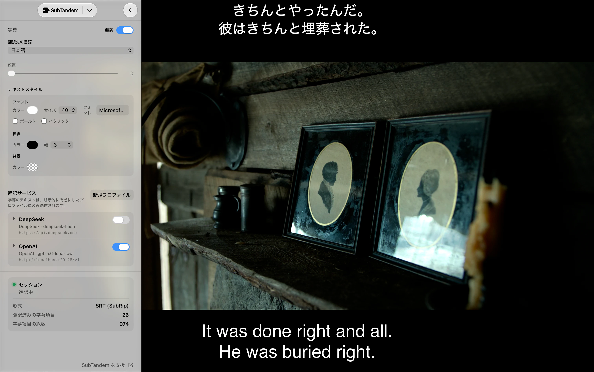

# SubTandem

**IINA向けリアルタイム二言語字幕翻訳**

[English](../../README.md) · [简体中文](README.zh-Hans.md) · [繁體中文](README.zh-Hant.md) · [한국어](README.ko.md) · **日本語** · [Русский](README.ru.md) · [العربية](README.ar.md) · [Français](README.fr.md)

---

SubTandemは、[IINA](https://iina.io/)で現在選択されているローカル動画の埋め込みテキスト字幕、または外部SRT/ASS字幕を翻訳し、独立したオーバーレイに自前で表示します。再生位置の少し先だけを範囲限定バッチで翻訳し、遅延や失敗時も元字幕の選択と動画の再生を維持します。

## 🎬 使用イメージ

SubTandemは元の字幕を表示したまま、選択した位置に翻訳字幕を独立して表示します。

## ✨ 機能

- **リアルタイム二言語字幕：** 元の字幕はIINAで選択したまま、SubTandemが別の字幕トラックを使わず、選択した垂直位置に翻訳を横方向中央揃えで表示します。
- **埋め込み・外部テキスト字幕：** ローカルMatroska SubRip/ASS/SSA、MOV/MP4 `mov_text`、外部SRT/ASSに対応します。抽出機能は同梱され、外部の`ffmpeg`や`ffprobe`は不要です。
- **翻訳サービスを選択可能：** OpenAI、Claude、DeepSeek、Ollamaを利用できます。OpenAIやClaudeと互換性のあるサービスにも接続できます。
- **再生を優先：** 翻訳処理によって動画が停止したり、元の字幕が非表示になったりすることはありません。
- **リクエスト範囲を制限：** 再生位置付近の字幕だけを翻訳し、プレイヤーウインドウごとに同時処理を制限します。成功した翻訳は現在の動画セッション内でのみキャッシュします。
- **翻訳スタイルを保持：** **字幕**でフォント、サイズ、ボールドとイタリック、文字色、枠線、背景をカスタマイズできます。色のプリセットとmacOSのカラー選択画面は透明度に対応し、スタイル設定は次回以降も使えるよう保存されます。
- **複数のプロファイル：** サービスやモデルごとに設定を保存し、その場で編集・テストして、有効なプロファイルを切り替えられます。有効化した選択はすべてのプレイヤーウインドウに適用され、IINAの再起動後も保持されます。
- **ネットワーク経路：** プロファイルごとに直接接続かシステムのプロキシ設定を選び、モデル一覧の更新、接続テスト、翻訳リクエストでサービスに接続する方法を指定できます。直接接続はシステムのプロキシを経由しません。新しいプロファイルは初期設定でシステムのプロキシ設定を使用します。
- **IINAと同じ表示言語：** IINA 1.5.0以降では、SubTandemはIINAの表示言語に自動で従い、IINA 1.5.0に含まれる全31言語・地域別バリエーションに対応します。操作項目、状態・エラーメッセージ、アクセシビリティ用テキスト、プラグインの説明、フォントとカラーの選択画面が対象です。システムが提供する選択画面の文言は、macOSで利用可能な言語に切り替わる場合があります。

## ✅ 動作要件

- macOS 12以降
- 空でない APIキー の保存と使用には Secure Enclave を備えた Mac が必要です。APIキー が不要なサービスは引き続き利用できます。
- IINA 1.4.0以降。表示言語の自動継承にはIINA 1.5.0以降が必要です。
- 対応するローカル埋め込みテキスト字幕、または読み取り可能な外部SRT/ASS/SSA字幕
- 利用可能なモデルを持つOpenAI、Claude、DeepSeek、Ollamaのいずれかのサービス。設定方法は以下を参照してください。

SubTandemは翻訳モデルをダウンロードしたり起動したりしません。

## 🚀 インストール

以下の手順とスクリーンショットは、IINA 1.5.0以降の英語表示を使用しています。**Settings → Plugins**を開き、**Get Plugins…**または**Install Local Package…**を選びます。

### Get Plugins

**Get Plugins…**をクリックし、次のいずれかの方法でインストールします。

- **リポジトリ名を入力：** 上部の`owner/repo`欄に`janwee-sha/SubTandem`と入力し、横の**Install**をクリックします。
- **コミュニティのプラグイン一覧から選択：** 一覧で**SubTandem**を選び、右側の詳細欄にある**Install**をクリックします。

インストールが完了したら、**Done**をクリックしてプラグイン管理画面に戻ります。

### Install Local Package

1. [Releases](https://github.com/janwee-sha/SubTandem/releases)ページから最新の`SubTandem-X.Y.Z.iinaplgz`パッケージをダウンロードします。
2. **Settings → Plugins**に戻り、**Install Local Package…**をクリックします。
3. ダウンロードした`.iinaplgz`ファイルを選択し、インストールを確定します。

いずれの方法でも、プラグインの権限を求められた場合は承認してください。インストール後、SubTandemの横にあるスイッチがオンになっていることを確認し、IINAを再起動します。その後、動画を再生してIINAのサイドバーを開き、**SubTandem**タブを選択します。

## 🌍 クイックスタート

SubTandemはIINAのアプリケーション言語に従います。言語を変更した後はIINAを再起動してください。古いIINA、未対応の言語、言語情報を取得できない場合や翻訳のない文言には英語を使用します。プラグイン独自の言語設定はありません。以下では日本語の操作項目名を使用します。実際の表示名はIINAの言語に従います。

1. ローカル動画を開き、対応する埋め込みテキスト字幕または外部SRT/ASSをIINAの主字幕として選択します。
2. **字幕**で正確なターゲット言語を選択します。選択した翻訳Providerが翻訳リクエスト内でcueごとのソース言語を理解するため、ソース言語の手動確認は不要です。
3. **翻訳サービス**で**新規プロファイル**を選び、OpenAI、Claude、DeepSeek、またはOllamaのprofileを作成します。新しい草稿は**システムのプロキシ設定を使用**が初期値です。認証が必要な場合はAPIキーを入力してからモデル一覧を手動更新します。
4. 左下の**テスト**で現在の草稿を保存せずに検証し、右下の**保存**で保存してから独立したスイッチをオンにします。テストの固定プローブは課金される場合がありますが、再生中の字幕送信、入力したkeyの保存、profileの有効化は行いません。
5. **翻訳**をオンにします。元の字幕はIINAでそのまま表示され、翻訳されたcueはSubTandemのオーバーレイに表示されます。**字幕**の**位置**で、オーバーレイを上（`0`）から下（`100`）まで移動できます。
6. **フォント**、**枠線**、**背景**の各グループで8項目のテキストスタイルを選びます。色のプリセットは直接保存され、**カラーを表示…**はmacOSのカラーパネルを開きます。変更せずに閉じた場合は以前の値を保持します。

Profileの概要を展開するとその場で編集できます。操作行は左に**テスト**、右に**キャンセル**、**削除**、**保存**の順で並び、新しい草稿には削除がありません。現在値をテストして保存した後、新しいリビジョンを有効化してください。

## ⚙️ 翻訳サービス

### OpenAI

- デフォルトのAPIのベースURLは`https://api.openai.com`です。OpenAI公式サービスでは、**APIキー**を入力し、アカウントで利用できるモデルを選びます。
- モデル一覧を更新してモデルを選ぶか、正確な**モデルID**を入力します。
- OpenAI互換サービスでは、**APIのベースURL**をそのサービスのAPIのベースURLに変更します。翻訳リクエストのURLはサイドバーに表示されます。APIキーが不要なサービスでは**APIキー**を空欄にできます。

### Claude

- デフォルトのAPIのベースURLは`https://api.anthropic.com`です。Claude公式サービスでは、Anthropicの**APIキー**を入力し、アカウントで利用できるモデルを選びます。
- モデル一覧を更新してモデルを選ぶか、正確な**モデルID**を入力します。
- Claude互換サービスでは、**APIのベースURL**をそのサービスのAPIのベースURLに変更します。サービスがAPIキーを必要としない場合は、**APIキー**を空欄にできます。キーがなくてもモデル一覧の更新、テスト、保存、有効化ができます。

### DeepSeek

- デフォルトのAPIのベースURLは`https://api.deepseek.com`です。DeepSeek公式サービスでは、**APIキー**を入力し、アカウントで利用できるモデルを選びます。
- モデル一覧を更新してモデルを選ぶか、正確な**モデルID**を入力します。SubTandemはDeepSeekモデルを自動選択しません。
- 別の互換APIのベースURLを使うサービスでは、**APIのベースURL**を変更します。

### Ollama

- デフォルトのサーバーアドレスは`http://127.0.0.1:11434`で、お使いのコンピューター上のOllamaに接続します。先にOllamaを起動し、対応モデルをインストールしてください。
- モデル一覧を更新してインストール済みモデルを選ぶか、正確な**モデルID**を入力します。
- リモートのOllamaサーバーでは、**APIのベースURL**をそのサーバーのアドレスに変更します。サーバーが要求する場合のみ**APIキー**を入力します。**テスト**で接続、モデル、構造化出力への対応を確認できます。

新しいprofileは**システムのプロキシ設定を使用**が初期値です。**ネットワーク経路**はモデル一覧の更新、接続テスト、翻訳に使用されます。システムのプロキシを使わずに接続するには**直接接続**を選びます。既存のprofileは保存済みの経路を保持し、現在の草稿で選んだ経路もサービスを切り替えて戻ると保持されます。

## 🔒 プライバシー、認証情報、料金

- SubTandemが明示的に選択したprofileへ送信するのは、再生位置付近の字幕テキスト、正確なターゲット言語、不透明なcue ID、少量の隣接コンテキストだけです。Providerは同じ翻訳リクエスト内でソース言語を理解します。動画や音声の内容は送信しません。
- `video-overlay`権限は、現在の翻訳をローカルの非対話型Overlayに表示するためだけに使います。Overlayは入力や動画上でのドラッグを受け付けず、ネットワークやWebViewストレージを使用せず、再生セッションとともに消去されます。
- APIキー は profile 設定とハードウェアに紐づく復元情報とともに、プラグイン専用の `credentials.json` に認証付き暗号文として保存されます。暗号鍵は Secure Enclave が保護します。必要なハードウェア保護を利用できない場合、空でない APIキー の保存と保存済み APIキー の使用は失敗します。空の APIキー と明示的な削除は利用できます。APIキー は IINA preferences、ログ、診断、配布パッケージに書き込まれません。 同じ Mac とユーザーでシステム鍵が有効な場合、新しく保存した APIキー は IINA の再起動、Mac の再起動とログイン、以後のプラグイン更新後も利用でき、追加の許可、マスターパスワード、生体認証は不要です。
- Profile を開くと保存済み APIキー を編集できます。最初はマスクされ、**APIキーを表示** で現在のドロワー内だけに表示されます。**保存** は現在の入力で置き換え、空欄で保存すると削除します。読み取りに失敗しても編集可能な空欄となり、保存済みデータは変更されません。**キャンセル** は編集を破棄します。
- 従来の平文形式から更新すると profile 設定と有効な選択は維持されますが、保存済み APIキー は消去されます。必要に応じて再入力してください。SubTandem は管理下のコピーを削除しますが、APFS/Time Machine スナップショット、オフラインコピー、その他のバックアップには古い APIキー が残る場合があります。サービス側で古い APIキー を更新してください。
- バックアップでは復元情報を含む完全な `credentials.json` を保存してください。復元には元のデバイス、ユーザー、有効なシステム鍵環境が必要で、その条件でも成功は保証されません。別のデバイスやユーザーでは保存済み APIキー を復元できません。各 profile に再入力してください。
- 翻訳は現在の動画セッション内でのみキャッシュされ、動画の変更、再生終了、ウインドウを閉じたときに消去されます。
- 短いトラック、ソース言語が不明なテキスト、正確なターゲット言語と同じテキストも選択済みProviderへ送信され、料金が発生する場合があります。Provider独自のポリシーが適用され、バッチ処理とセッションキャッシュは呼び出し回数を減らしますが料金上限は保証しません。

## 📌 現在の対象範囲

SubTandemは、音声文字起こし、画像ベース字幕のOCR/抽出、リモートメディアの埋め込み字幕抽出、動画全体の事前翻訳、書き出し、クラウド同期、永続キャッシュには対応していません。抽出した一時データは解析、取消、タイムアウト、終了時に削除します。

## 🛠️ トラブルシューティング

- **対応するテキスト字幕を選択:** ローカル埋め込みSubRip/ASS/SSA/`mov_text`または外部SRT/ASSを主字幕として選択してください。画像ベースとリモート埋め込み字幕は非対応です。状態表示に従って再選択するか、準備失敗後に再試行してください。
- **翻訳に失敗する：** セッションに表示される具体的な対処方法に従ってください。原因に応じてprofileをテストし、APIのベースURL、正確なモデルID、APIキー、ネットワーク経路、アカウント上限、Ollamaプロセスを確認します。再生と元字幕は通常どおり継続します。
- **起動後に profile 一覧が空になる：** 保存済み設定を読み込めなくても **新規プロファイル** は利用できます。破損した設定はリセットされる場合があるため、新しい profile を作成して保存すると利用を再開できます。一時的なアクセス障害では有効な保存済み profile は保持され、アクセスが戻ると再表示できます。保存に失敗しても草稿は再試行のために残ります。単一の APIキー の読み取り失敗では一覧はリセットされません。
- **認証情報を保存できない:** 不完全な開発用コピーではなくReleaseパッケージをインストールし、プラグインデータディレクトリが書き込み可能であることを確認してから、IINAを完全に終了して再起動してください。
- **翻訳が表示されない：** 対象profileのスイッチと**翻訳**が両方オンであり、再生位置が翻訳済みcueの時間範囲内にあることを確認してください。
- **ネットワークやプロキシの問題：** 新しいprofileはシステムのプロキシ設定を使用します。システムのプロキシ設定を確認するか、そのprofileで**直接接続**を選び、保存、テスト、新しいリビジョンの有効化を行ってください。

## ☕ SubTandemを支援

SubTandemがお役に立った場合は、[Afdian](https://www.ifdian.net/item/ea1ff37a97ed11f19a9f52540025c377?utm_source=copylink&utm_medium=link)または[Ko-fi](https://ko-fi.com/ianhsia)で、作者にコーヒーを一杯おごる形で任意に支援できます。
