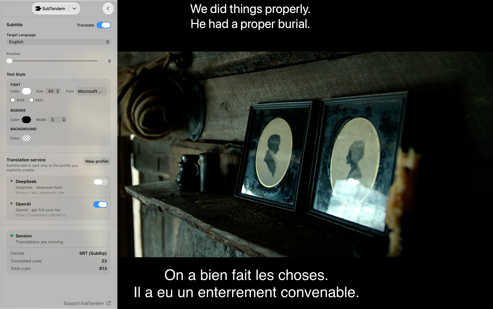
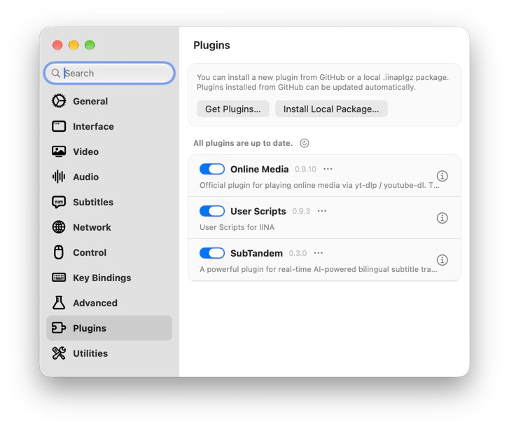
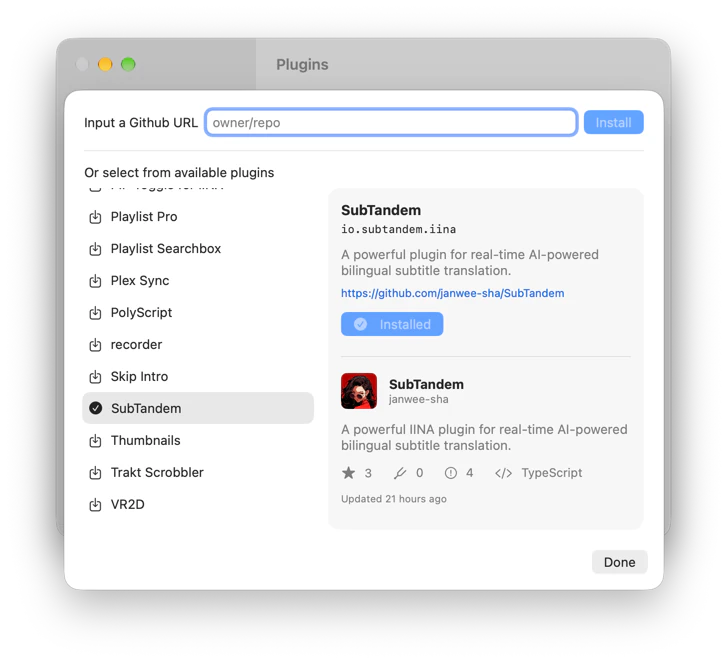

# SubTandem

**Перевод двуязычных субтитров в реальном времени для IINA**

[English](../../README.md) · [简体中文](README.zh-CN.md) · [繁體中文](README.zh-Hant.md) · [한국어](README.ko.md) · [日本語](README.ja.md) · **Русский** · [العربية](README.ar.md) · [Français](README.fr.md)

---

SubTandem переводит встроенные текстовые субтитры локального видео или внешний SRT/ASS, выбранный в [IINA](https://iina.io/), и самостоятельно показывает перевод в отдельном оверлее. Плагин обрабатывает только небольшой участок рядом с текущей позицией ограниченными пакетами; при задержке или ошибке видео и оригинал продолжают воспроизводиться.

## 🎬 Как это выглядит

SubTandem сохраняет оригинальные субтитры и отдельно показывает перевод в выбранной вами позиции.

## ✨ Возможности

- **Двуязычные субтитры в реальном времени:** оригинал остаётся выбранным в IINA, а SubTandem показывает перевод по центру на выбранной вертикальной позиции, не занимая другую дорожку субтитров.
- **Встроенные и внешние текстовые субтитры:** поддерживаются локальные Matroska SubRip/ASS/SSA, MOV/MP4 `mov_text` и внешние SRT/ASS. Средство извлечения включено в пакет; внешний `ffmpeg` или `ffprobe` не нужен.
- **Выбор службы перевода:** используйте OpenAI, Claude, DeepSeek или Ollama. Также можно подключить службы, совместимые с OpenAI или Claude.
- **Приоритет воспроизведения:** перевод не приостанавливает видео и не скрывает оригинальные субтитры.
- **Ограниченные запросы:** переводятся только субтитры рядом с текущей позицией воспроизведения, число одновременных задач ограничено для каждого окна, а успешные результаты кэшируются только в текущем сеансе видео.
- **Сохранение стиля перевода:** в разделе **Субтитры** можно настроить шрифт, размер, полужирное и курсивное начертание, цвет текста, рамку и фон. Цветовые пресеты и окно выбора цвета macOS поддерживают прозрачность, а настройки стиля сохраняются для дальнейшего использования.
- **Несколько профилей:** сохраняйте настройки разных служб и моделей, редактируйте и проверяйте их прямо в списке, а затем переключайте активный профиль. Выбор действует во всех окнах плеера и сохраняется после перезапуска IINA.
- **Сетевой маршрут:** для каждого профиля можно выбрать прямое подключение или системные настройки прокси для обновления списка моделей, проверки соединения и запросов перевода. Прямое подключение обходит системный прокси; новые профили по умолчанию используют системные настройки прокси.
- **Интерфейс на языке IINA:** в IINA 1.5.0 и новее SubTandem автоматически следует языку интерфейса IINA и поддерживает все 31 языковой вариант из IINA 1.5.0. Переведены элементы управления, сообщения о состоянии и ошибках, тексты для специальных возможностей, описание плагина и окна выбора шрифта и цвета. Системные тексты окон выбора могут отображаться на другом доступном в macOS языке.

## ✅ Требования

- macOS 12 или новее
- Mac с Secure Enclave для сохранения или использования непустого API key; сервисы, которым ключ не нужен, по-прежнему поддерживаются.
- IINA 1.4.0 или новее; автоматический выбор языка интерфейса требует IINA 1.5.0 или новее
- Поддерживаемая локальная встроенная текстовая дорожка или внешний SRT/ASS/SSA
- Служба OpenAI, Claude, DeepSeek или Ollama и доступная вам модель. Настройка каждой службы описана ниже.

SubTandem не загружает и не запускает модели перевода.

## 🚀 Установка

Шаги и снимки экрана ниже показаны для английского интерфейса IINA 1.5.0 или новее. Откройте **Settings → Plugins** и выберите **Get Plugins…** или **Install Local Package…**.

### Get Plugins

Нажмите **Get Plugins…**, затем выберите один из двух способов установки:

- **Ввести имя репозитория:** введите `janwee-sha/SubTandem` в поле `owner/repo` вверху и нажмите **Install** рядом с ним.
- **Выбрать из списка плагинов сообщества:** выберите **SubTandem** в списке и нажмите **Install** на панели сведений справа.

После завершения установки нажмите **Done**, чтобы вернуться в менеджер плагинов.

### Install Local Package

1. Откройте страницу [Releases](https://github.com/janwee-sha/SubTandem/releases) и загрузите последний пакет `SubTandem-X.Y.Z.iinaplgz`.
2. Вернитесь в **Settings → Plugins** и нажмите **Install Local Package…**.
3. Выберите загруженный файл `.iinaplgz` и подтвердите установку.

При любом способе подтвердите запрошенные разрешения плагина, если IINA их покажет. После установки убедитесь, что переключатель рядом с SubTandem включён, и перезапустите IINA. Затем запустите видео, откройте боковую панель IINA и выберите вкладку **SubTandem**.

## 🌍 Быстрый старт

SubTandem следует языку приложения IINA. После смены языка перезапустите IINA. В старых версиях, при неподдерживаемом языке или недоступных данных о языке используется английский; отсутствующие переводы также заменяются английским текстом. Отдельной настройки языка плагина нет. Ниже приведены русские названия элементов управления; фактические названия зависят от языка IINA.

1. Откройте локальное видео и выберите в IINA поддерживаемые встроенные текстовые субтитры или внешний SRT/ASS как основную дорожку.
2. В разделе **Субтитры** выберите точный целевой язык. Выбранный сервис определяет исходный язык каждого cue внутри запроса перевода; подтверждать исходный язык вручную не нужно.
3. В разделе **Сервис перевода** выберите **Новый профиль** и создайте OpenAI, Claude, DeepSeek или Ollama profile. Новый черновик использует **Использовать системные настройки прокси** по умолчанию. При необходимости введите API key и вручную обновите список моделей.
4. Кнопкой **Проверить** слева внизу проверьте текущий черновик без сохранения, затем нажмите **Сохранить** справа и включите независимый переключатель. Фиксированный тестовый запрос может тарифицироваться, но не отправляет текущие субтитры, не сохраняет введённый key и не включает profile.
5. Включите **Переводить**. Оригинал продолжит отображаться в IINA, а переведённые cue появятся в оверлее SubTandem. Параметр **Позиция** в разделе **Субтитры** перемещает оверлей от верха (`0`) к низу (`100`).
6. Выберите восемь параметров текста в группах **Шрифт**, **Рамка** и **Фон**. Пресет цвета сохраняется сразу; **Показать цвета…** открывает системную панель цветов macOS, а закрытие без изменений сохраняет прежнее значение.

Раскройте сводку profile для редактирования на месте. В строке действий **Проверить** находится слева, а **Отмена**, **Удалить**, **Сохранить** — справа; в новом черновике кнопка **Удалить** отсутствует. Проверьте текущие значения, сохраните их и включите новую ревизию.

## ⚙️ Службы перевода

### OpenAI

- API root по умолчанию — `https://api.openai.com`. Для официального OpenAI укажите **Ключ API** и выберите модель, доступную вашей учётной записи.
- Обновите список моделей и выберите модель либо введите её точный **ID модели**.
- Для службы, совместимой с OpenAI, замените **Корневой адрес API** на её API root. URL запроса перевода отображается на боковой панели. Оставьте **Ключ API** пустым, если служба принимает запросы без него.

### Claude

- API root по умолчанию — `https://api.anthropic.com`. Для официального Claude укажите **Ключ API** Anthropic и выберите модель, доступную вашей учётной записи.
- Обновите список моделей и выберите модель либо введите её точный **ID модели**.
- Для службы, совместимой с Claude, замените **Корневой адрес API** на её API root. Оставьте **Ключ API** пустым, если служба принимает запросы без ключа. Список моделей можно обновлять, а profile проверять, сохранять и включать без ключа.

### DeepSeek

- API root по умолчанию — `https://api.deepseek.com`. Для официального DeepSeek укажите **Ключ API** и выберите модель, доступную вашей учётной записи.
- Обновите список моделей и выберите модель либо введите её точный **ID модели**. SubTandem не выбирает модель DeepSeek автоматически.
- Если служба использует другой совместимый API root, измените **Корневой адрес API**.

### Ollama

- Адрес сервера по умолчанию — `http://127.0.0.1:11434` для Ollama на вашем компьютере. Сначала запустите Ollama и установите совместимую модель.
- Обновите список моделей и выберите установленную модель либо введите её точный **ID модели**.
- Для удалённого сервера Ollama измените **Корневой адрес API** на его адрес. Указывайте **Ключ API**, только если сервер его требует. **Проверить** проверяет соединение, модель и поддержку структурированного вывода.

Новый profile по умолчанию использует **Использовать системные настройки прокси**. **Способ подключения** применяется к обновлению моделей, проверке соединения и переводу; выберите **Подключаться напрямую**, чтобы обойти системный прокси. Существующий profile сохраняет записанный маршрут, а маршрут текущего черновика сохраняется при переключении на другую службу и обратно.

## 🔒 Конфиденциальность, учётные данные и стоимость

- SubTandem отправляет только явно выбранному profile ближайший текст cue, точный целевой язык, непрозрачные идентификаторы cue и небольшой соседний контекст. Сервис определяет исходный язык внутри того же запроса перевода. Видео и аудио не отправляются.
- Разрешение `video-overlay` используется только для показа текущего перевода в локальном неинтерактивном Overlay. Overlay не принимает ввод и перетаскивание на видео, не использует сеть или хранилище WebView и очищается вместе с сеансом воспроизведения.
- API key сохраняются как аутентифицированные зашифрованные данные в приватном `credentials.json` вместе с настройками profile и аппаратно привязанными материалами восстановления. Secure Enclave защищает ключи шифрования. Если необходимая аппаратная защита недоступна, сохранение непустого API key и использование сохранённого API key завершаются ошибкой. Пустой API key и его явное удаление остаются доступны. API key не записываются в IINA preferences, журналы, диагностику или пакет. На том же Mac и в той же учётной записи с действующими системными ключами новые сохранённые API key остаются доступны после перезапуска IINA, перезапуска Mac и входа в систему, а также последующих обновлений плагина, без дополнительных разрешений, главного пароля или биометрических запросов.
- Откройте profile для редактирования сохранённого API key. По умолчанию он скрыт; **Показать ключ API** показывает значение только в текущей панели. **Сохранить** заменяет его текущим вводом, а сохранение пустого поля удаляет его. При ошибке чтения остаётся редактируемое пустое поле, сохранённые данные не меняются. **Отмена** отменяет правки.
- Обновление с прежнего текстового формата сохраняет настройки profile и допустимый активный выбор, но очищает сохранённые API key. При необходимости введите их снова. SubTandem очищает управляемые им копии; снимки APFS/Time Machine, автономные копии и другие резервные копии могут содержать старые API key. Замените старые API key у своего сервиса.
- Сохраните полный `credentials.json` вместе с материалами восстановления. Для восстановления нужны исходное устройство, пользователь и действующее окружение системных ключей; даже в этих условиях успех не гарантирован. Другое устройство или пользователь не может восстановить сохранённые API key; введите их заново для каждого profile.
- Переводы кэшируются только для текущего сеанса видео и удаляются при смене видео, завершении воспроизведения или закрытии окна.
- Короткие дорожки, текст с неизвестным исходным языком и текст, уже совпадающий с точным целевым языком, всё равно отправляются выбранному Provider и могут тарифицироваться. Действуют правила Provider; пакетная обработка и кэш сеанса уменьшают число вызовов, но не гарантируют предел расходов.

## 📌 Текущие границы

SubTandem не выполняет расшифровку аудио, OCR/извлечение графических субтитров, извлечение встроенных субтитров из удалённого медиа, полный предварительный перевод, экспорт, облачную синхронизацию или постоянный кэш. Временные данные удаляются после разбора, отмены, тайм-аута или завершения.

## 🛠️ Устранение неполадок

- **Выберите поддерживаемые текстовые субтитры:** выберите локальную встроенную дорожку SubRip/ASS/SSA/`mov_text` или внешний SRT/ASS. Графические и удалённые встроенные дорожки не поддерживаются; следуйте состоянию для выбора другой дорожки или нажмите **Повторить** после ошибки подготовки.
- **Ошибка перевода:** выполните конкретное действие, указанное в разделе **Сеанс**. В зависимости от причины проверьте profile, API root, точный Model ID, API key, сетевой маршрут, лимиты учётной записи или процесс Ollama. Воспроизведение и исходные субтитры продолжат работать как обычно.
- **Пустой список profile после запуска:** если сохранённые настройки не загружаются, кнопка **Новый профиль** остаётся доступной. Повреждённые настройки могут быть сброшены; создайте и сохраните новый profile, чтобы продолжить. Временная ошибка доступа не перезаписывает допустимые сохранённые profile; они могут появиться снова после восстановления доступа. При ошибке сохранения черновик остаётся для повторной попытки. Ошибка чтения одного API key не сбрасывает список.
- **Не удалось сохранить учётные данные:** установите пакет Release вместо неполной копии для разработки, проверьте доступность каталога данных плагина для записи и полностью перезапустите IINA.
- **Перевод не отображается:** убедитесь, что переключатель нужного profile и **Переводить** включены, а текущая позиция находится во временном интервале уже переведённого cue.
- **Проблемы с сетью или прокси:** новые profile используют системные настройки прокси. Проверьте их или выберите **Подключаться напрямую** для этого profile, затем сохраните, проверьте и включите новую ревизию.

## ☕ Поддержать SubTandem

Если SubTandem оказался полезен, вы можете добровольно угостить автора кофе через [Afdian](https://www.ifdian.net/item/ea1ff37a97ed11f19a9f52540025c377?utm_source=copylink&utm_medium=link) или [Ko-fi](https://ko-fi.com/ianhsia).
