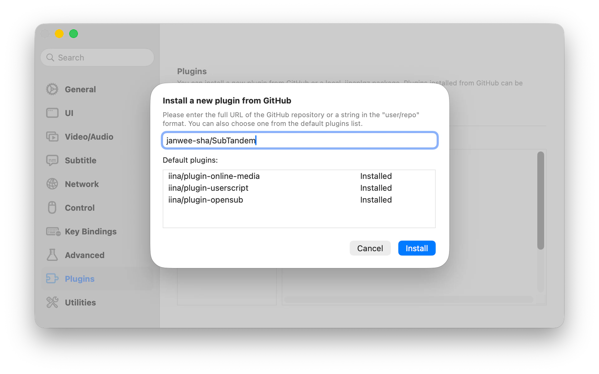
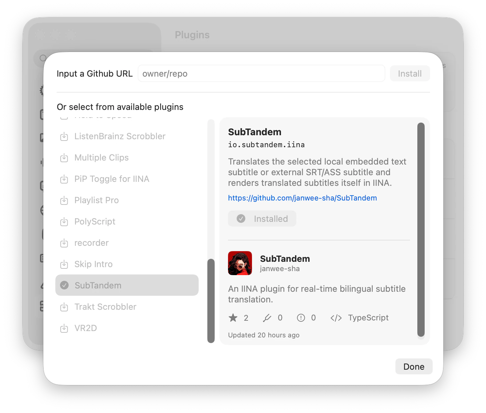
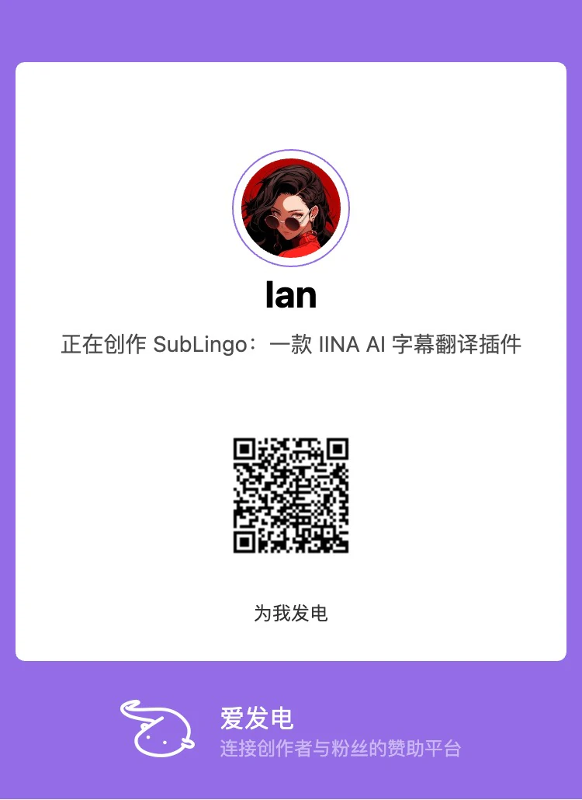

# SubTandem

**為 IINA 提供即時雙語字幕翻譯**

[English](../../README.md) · [简体中文](README.zh-CN.md) · **繁體中文** · [한국어](README.ko.md) · [日本語](README.ja.md) · [Русский](README.ru.md) · [العربية](README.ar.md) · [Français](README.fr.md)

---

SubTandem 翻譯 [IINA](https://iina.io/) 目前選取的本機內嵌文字字幕或外部 SRT/ASS 字幕，並自行顯示譯文。它只在播放位置附近有限度地預先分批翻譯；即使翻譯延遲或失敗，原字幕選擇與影片播放也不受影響。

## 🎬 使用效果

SubTandem 保留原字幕，同時在你選擇的位置獨立顯示譯文。

## ✨ 功能

- **即時雙語字幕：** 原字幕繼續由 IINA 顯示，SubTandem 在你選擇的垂直位置水平置中顯示譯文，不占用其他字幕軌。
- **支援內嵌與外部文字字幕：** 支援本機 Matroska SubRip/ASS/SSA、本機 MOV/MP4 `mov_text`，以及外部 SRT/ASS；正式套件內附擷取功能，無須安裝 `ffmpeg` 或 `ffprobe`。
- **自選翻譯服務：** 可使用 OpenAI、Claude、DeepSeek 或 Ollama，也可連線至相容於 OpenAI 或 Claude 的服務。
- **播放優先：** 翻譯工作不會暫停影片，也不會隱藏原字幕。
- **限制請求範圍：** 只翻譯播放位置附近的字幕；每個播放器視窗限制同時執行的工作數；成功譯文只在目前影片的工作階段內快取。
- **儲存譯文樣式：** 可在 **字幕** 中自訂字體、字體大小、粗體與斜體、文字色彩、邊框和背景。色彩預設與 macOS 色彩選擇器支援透明度，樣式設定會儲存供後續使用。
- **多個設定組：** 可儲存不同服務和模型的設定組，就地編輯、測試並切換啟用的設定組。啟用選擇在所有播放器視窗間生效，並在重新啟動 IINA 後保留。
- **網路路由：** 可為每個設定組選擇直接連線或使用系統代理伺服器設定，決定重新整理模型、測試連線和翻譯請求如何連線至服務。直接連線會略過系統代理伺服器；新設定組預設使用系統代理伺服器設定。
- **跟隨 IINA 的介面語言：** 在 IINA 1.5.0 及之後版本中，SubTandem 自動跟隨 IINA 的介面語言，涵蓋 IINA 1.5.0 隨附的全部 31 種語言變體。控制項、狀態與錯誤提示、輔助使用文字、外掛程式描述及字體和色彩選擇器均使用該語言。系統選擇器文字可能改用 macOS 可用的語言。

## ✅ 使用需求

- macOS 12 或更新版本
- 儲存或使用非空白的 API 金鑰需要配備 Secure Enclave 的 Mac；不需要 API 金鑰的服務仍受支援。
- IINA 1.4.0 或更新版本；自動跟隨介面語言需要 IINA 1.5.0 或更新版本
- 受支援的本機內嵌文字字幕，或可讀取的外部 SRT/ASS/SSA 字幕
- 可使用的 OpenAI、Claude、DeepSeek 或 Ollama 翻譯服務及模型；各服務的設定方法見下文。

SubTandem 不會下載或啟動翻譯模型。

## 🚀 安裝

開啟 IINA，進入「**偏好設定 → 外掛程式**」。外掛程式管理介面支援以下安裝方式。

### 從 GitHub 安裝（建議）

1. 按一下「**從 GitHub 安裝…**」。
2. 在 `user/repo` 輸入框中填入 `janwee-sha/SubTandem`，然後確認安裝。
3. 等待 SubTandem 出現在「已安裝的外掛」列表中。

SubTandem v0.1.0 已包含 IINA 更新中繼資料。使用上述任一方式完成安裝後，IINA 可以檢查並安裝後續版本。

### 安裝下載的外掛套件

1. 開啟 [Releases](https://github.com/janwee-sha/SubTandem/releases) 頁面，下載最新的 `SubTandem-X.Y.Z.iinaplgz`。
2. 返回「**偏好設定 → 外掛程式**」，按一下「**安裝外掛…**」。
3. 選擇剛下載的 `.iinaplgz` 檔案並確認安裝。

### 從外掛程式列表安裝（開發版 IINA）

開發版 IINA 可以直接從可用外掛程式列表安裝 SubTandem。

1. 開啟「**偏好設定 → 外掛程式**」，進入新外掛程式安裝介面。
2. 在可用外掛程式列表中選擇 **SubTandem**。
3. 確認安裝，並等待 SubTandem 出現在「已安裝的外掛」列表中。

無論使用哪種方式，如 IINA 提示授權，請允許所要求的外掛程式權限；確認 SubTandem 左側的核取方塊已勾選，然後重新啟動 IINA。之後播放影片、開啟 IINA 側邊欄並選擇 **SubTandem** 分頁。

## 🌍 快速入門

SubTandem 跟隨 IINA 的應用程式語言，變更後需重新啟動 IINA。較舊的 IINA 版本、不支援的語言或無法讀取語言資訊時會使用英文；缺少的文字也會改用英文。外掛程式沒有獨立的語言設定。下文使用繁體中文控制項名稱，實際名稱隨 IINA 語言變化。

1. 開啟本機影片，並在 IINA 中選擇受支援的內嵌文字字幕或外部 SRT/ASS 作為主字幕。
2. 在 **字幕** 中選擇確切的目標語言。目前翻譯服務會在翻譯請求內逐條理解來源語言，無須手動確認來源語言。
3. 在 **翻譯服務** 中按一下 **新增設定組**，建立 OpenAI、Claude、DeepSeek 或 Ollama 設定組。新草稿預設為 **使用系統代理伺服器設定**。服務需要驗證時，先填入 API 金鑰，再手動重新整理模型清單；選擇傳回的模型，或填入確切的自訂模型 ID。
4. 用左下角的 **測試** 測試目前草稿，再用右下角的 **儲存** 儲存，並開啟獨立開關。測試可能產生固定探測請求的費用，但不會傳送正在播放的字幕、儲存新輸入的金鑰或啟用設定組。
5. 開啟 **翻譯**。原字幕仍由 IINA 正常顯示，譯文會出現在 SubTandem 覆蓋層中。可在 **字幕** 中用 **位置** 將覆蓋層從頂部（`0`）調整到底部（`100`）。
6. 在 **字體**、**邊框** 與 **背景** 群組中設定八項文字樣式。選擇色彩預設會直接儲存；選擇 **顯示色彩…** 可開啟 macOS 系統色彩面板，未修改便關閉時會保留原值。

展開設定組摘要即可就地編輯。操作列左側是 **測試**，右側依序是 **取消**、**刪除**、**儲存**；新草稿不顯示 **刪除**。測試目前值並儲存後，再啟用新修訂版。

## ⚙️ 翻譯服務

### OpenAI

- 預設 API 根網址是 `https://api.openai.com`。使用 OpenAI 官方服務時，填入 **API 金鑰**，並選擇帳號可用的模型。
- 重新整理模型清單並選擇模型，或填入確切的 **模型 ID**。
- 使用相容於 OpenAI 的服務時，將 **API 根網址** 改為該服務的 API 根網址。側邊欄會顯示翻譯請求網址。如果該服務無須 API 金鑰，可將 **API 金鑰** 留空。

### Claude

- 預設 API 根網址是 `https://api.anthropic.com`。使用 Claude 官方服務時，填入 Anthropic **API 金鑰**，並選擇帳號可用的模型。
- 重新整理模型清單並選擇模型，或填入確切的 **模型 ID**。
- 使用相容於 Claude 的服務時，將 **API 根網址** 改為該服務的 API 根網址。如果該服務無須 API 金鑰，可將 **API 金鑰** 留空；仍可重新整理模型、測試、儲存和啟用設定組。

### DeepSeek

- 預設 API 根網址是 `https://api.deepseek.com`。使用 DeepSeek 官方服務時，填入 **API 金鑰**，並選擇帳號可用的模型。
- 重新整理模型清單並選擇模型，或填入確切的 **模型 ID**。SubTandem 不會替你預選 DeepSeek 模型。
- 如果服務使用其他相容的 API 根網址，可以修改 **API 根網址**。

### Ollama

- 預設服務網址是 `http://127.0.0.1:11434`，用於連線至你電腦上的 Ollama。請先啟動 Ollama 並安裝相容的模型。
- 重新整理模型清單並選擇已安裝的模型，或填入確切的 **模型 ID**。
- 使用遠端 Ollama 時，將 **API 根網址** 改為伺服器網址。僅在伺服器要求時才填入 **API 金鑰**。**測試** 會檢查連線、模型和結構化輸出支援。

新設定組預設為 **使用系統代理伺服器設定**。**網路連線方式** 用於重新整理模型、測試連線和翻譯；選擇 **直接連線** 可略過系統代理伺服器。既有設定組保留已儲存的路由，目前草稿中選擇的路由在切換服務後再切回來時也會保留。

## 🔒 隱私、憑證與費用

- SubTandem 只向你明確全域啟用的唯一設定組傳送播放位置附近的字幕文字、確切的目標語言、不透明的字幕 ID 和少量相鄰上下文；服務會在該翻譯請求內理解來源語言。SubTandem 不會傳送影片或音訊內容。
- `video-overlay` 權限只用於在本機非互動式覆蓋層中顯示目前譯文。覆蓋層不接受輸入，不支援在播放器畫面拖曳，不使用網路或 WebView 儲存空間，並隨播放工作階段清理。
- API 金鑰以經過驗證的密文儲存在外掛程式私有的 `credentials.json` 中，與設定組設定及綁定硬體的復原資料一同儲存。Secure Enclave 保護加密金鑰；所需硬體保護無法使用時，非空白 API 金鑰的儲存和已儲存 API 金鑰的使用會失敗。空白 API 金鑰和明確清除仍可用。API 金鑰不會寫入 IINA 偏好設定、日誌、診斷或安裝套件。在同一部 Mac、同一位使用者且系統金鑰有效時，新儲存的 API 金鑰在重新啟動 IINA、重新啟動 Mac 並登入或後續外掛程式升級後仍可用，無須額外授權、主密碼或生物辨識。
- 開啟設定組可編輯已儲存的 API 金鑰。預設會遮蔽內容，**顯示 API 金鑰** 僅在目前的編輯面板顯示原值。**儲存** 以目前輸入取代原值，儲存空白值會清除金鑰；讀取失敗時仍顯示可編輯的空白欄位，不改變已儲存的資料。**取消** 會捨棄修改。
- 從原明文格式升級會保留設定組設定和有效的啟用選擇，但清空已儲存的 API 金鑰，請視需要重新輸入。SubTandem 會清理其管理的副本；APFS/Time Machine 快照、離線副本和其他備份仍可能保留舊 API 金鑰。建議在服務端輪替舊 API 金鑰。
- 備份時保留完整的 `credentials.json` 及其中配套的復原資料。復原依賴原裝置、原使用者和有效的系統金鑰環境，即使條件滿足也不保證成功。其他裝置或使用者無法復原已儲存的 API 金鑰，請為各設定組重新輸入。
- 處理內嵌文字字幕時，隨附的擷取工具只讀取目前本機媒體中選取的字幕軌，並產生供目前工作階段使用的暫存 SRT；不會擷取遠端媒體和圖像字幕，剖析、取消、逾時或結束後會清理暫存資料。
- 譯文只在目前影片的工作階段內快取；切換影片、播放結束或關閉視窗時會清除。
- 字幕軌較短、來源語言不明及已符合確切目標語言的內容仍會傳送到所選服務，並可能產生費用。服務適用其自身的資料與內容政策；批次處理和工作階段快取可以減少呼叫次數，但不保證費用上限。

## 📌 目前範圍

SubTandem 不提供音訊轉錄、圖像字幕 OCR／擷取、遠端媒體內嵌字幕擷取、整部影片預先翻譯、譯文匯出、雲端同步或持久譯文快取。

## 🛠️ 疑難排解

- **選擇受支援的文字字幕：** 在 IINA 中選擇本機內嵌 SubRip/ASS/SSA/`mov_text` 或外部 SRT/ASS 作為主字幕。不支援遠端內嵌和圖像字幕；可依狀態提示重新選擇字幕軌，或對失敗的準備操作執行 **重試**。
- **翻譯失敗：** 依照 **工作階段** 顯示的具體操作處理。根據失敗原因測試設定組，並檢查 API 根網址、確切的模型 ID、API 金鑰、網路路由、帳號限額或 Ollama 程序。影片和原字幕會繼續正常播放。
- **啟動後出現空白設定組清單：** 無法載入已儲存的設定時，仍可使用 **新增設定組**。損壞的設定可能會重設，可新增並儲存設定組後繼續使用。暫時存取失敗不會覆寫有效的已儲存設定組，存取恢復後它們可以重新出現。儲存失敗會保留草稿供重試。單一 API 金鑰讀取失敗不會重設清單。
- **無法儲存憑證：** 使用正式 Release 安裝套件，避免使用內容不完整的開發副本；確認外掛程式資料目錄可寫入，並完全結束後重新啟動 IINA。
- **沒有顯示譯文：** 確認目標設定組開關和 **翻譯** 均已開啟；播放位置還需要處於已有譯文的字幕時段內。
- **網路或代理伺服器故障：** 新設定組預設使用系統代理伺服器設定。請檢查系統代理伺服器設定，或為該設定組選擇 **直接連線**，然後儲存、測試並啟用新修訂版。

## ☕ 支持 SubTandem

如果 SubTandem 對你有幫助，可以透過[愛發電](https://www.ifdian.net/item/ea1ff37a97ed11f19a9f52540025c377?utm_source=copylink&utm_medium=link)或 [Ko-fi](https://ko-fi.com/ianhsia) 自願請創作者喝杯咖啡。

